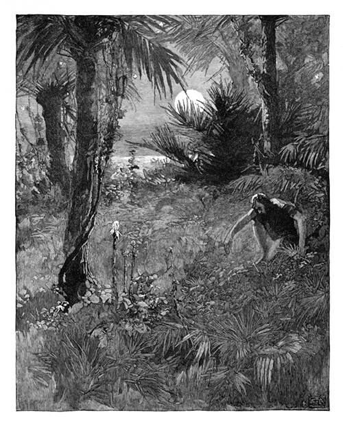

# Cosmos

> A personal digital garden.



---

## Quick Start

```bash
npm install
npm run dev          # → http://localhost:3001
npm run build        # → dist/
npm run lint         # TypeScript type check
npm run preview      # Preview production build
```

## Features

| Phase | Feature | Description |
|-------|---------|-------------|
| 1 | Code Blocks | Expressive Code powered blocks with copy button, language badge, line numbers, line/word highlighting, and switchable theme picker (GitHub Light, Vitesse Dark, Dracula, Catppuccin) |
| 2 | Emoji Shortcodes | Type `:rocket:` and get — with accessible `<span role="img">` markup for screen readers. Emoticons like `:)` also supported |
| 3 | Link Cards | Bare URLs auto-fetch Open Graph metadata and render as rich cards; inline links keep hover popups. `:::linkcard` directive opens markdown detail in a modal |
| 4 | Media Embedding | YouTube/Bilibili auto-embed, self-hosted video, ambient player, and subtitle mining with live transcript via `SubtitlePlayer` component |
| 5 | i18n & Pinyin | Full internationalization (EN/DE/ZH) with locale-prefixed URLs, language switcher, translated tags, and pinyin ruby annotations for Chinese text |
| 6 | GIF Hover Previews | Hover GitHub links or the CV button to see a floating GIF preview that follows your cursor, with viewport clamping and transparency support |

## License

This work is licensed under [CC BY 4.0](https://creativecommons.org/licenses/by/4.0/).

## Credits

- Vintage illustrations from [Old Book Illustrations](https://www.oldbookillustrations.com)

